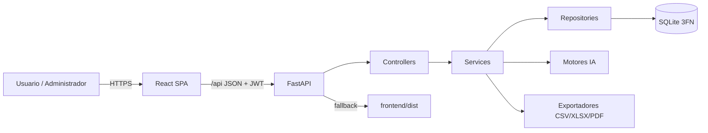
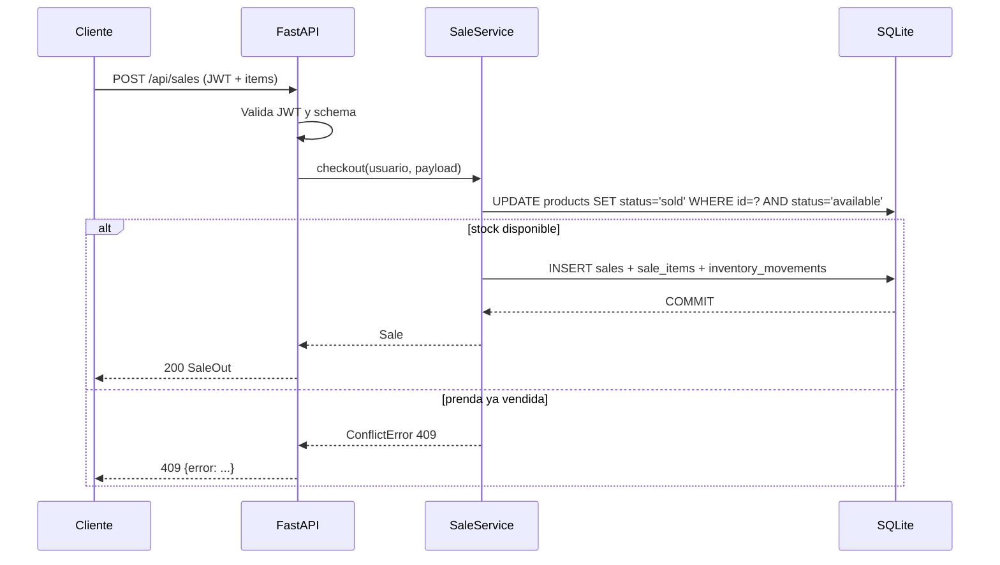
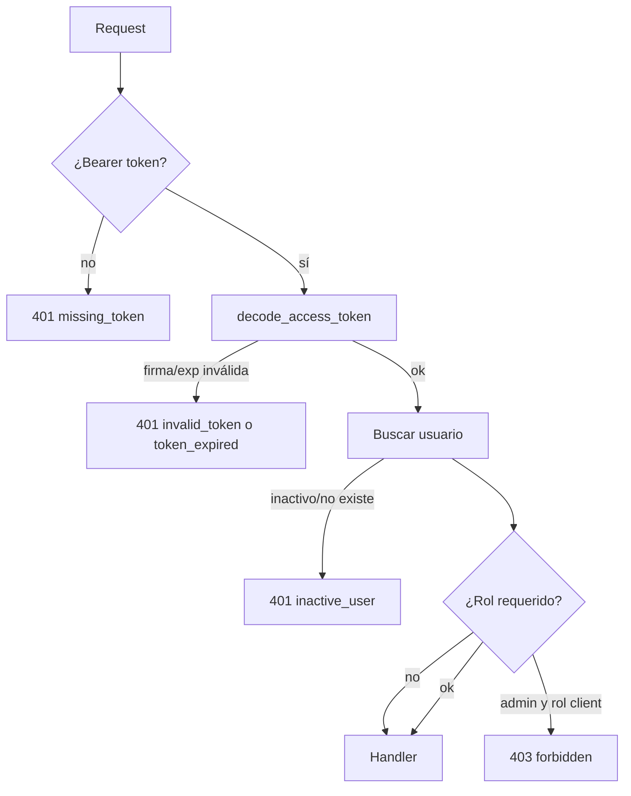

# Arquitectura — CAOS Vintage

Documento de diseño técnico: capas, programación orientada a objetos, patrones, flujos, manejo de errores, frontend y decisiones de despliegue.

---

## 1. Vista general



En desarrollo hay dos procesos: Vite (`5173`) y Uvicorn (`8010`). En producción, un único proceso FastAPI sirve la API y la SPA compilada.

---

## 2. Backend: MVC por capas

La arquitectura es **MVC en capas**, con dependencias en un solo sentido:

```
Controller → Service → Repository → Model → Base de datos
```

| Capa | Responsabilidad | Ejemplos |
| --- | --- | --- |
| **Controller** | Routing HTTP, contratos de entrada/salida, códigos de estado, inyección de dependencias. No contiene reglas de negocio. | `controllers/product_controller.py`, `sale_controller.py` |
| **Service** | Reglas de negocio, autorización fina, transacciones, coordinación de repositorios y motores IA. | `services/sale_service.py`, `catalog_service.py`, `pricing_service.py` |
| **Repository** | Consultas y persistencia SQLAlchemy. No conoce HTTP. | `repositories/sale_repository.py`, `report_repository.py` |
| **Model** | Entidades, relaciones, constraints y propiedades derivadas. | `models/catalog.py`, `sale.py`, `user.py` |
| **Schema** | DTOs Pydantic de request/response; validación de tipos y reglas de formato. | `schemas/product.py`, `schemas/sale.py` |
| **Core** | Configuración, seguridad, dependencias compartidas y excepciones. | `core/config.py`, `security.py`, `dependencies.py` |

### Flujo de una petición

Ejemplo: `POST /api/sales` (checkout).

1. `sale_controller.checkout` recibe el JSON y valida el schema `SaleCreate`.
2. La dependencia `get_current_user` decodifica el JWT y carga el usuario activo.
3. `SaleService.checkout` valida stock, calcula totales, descuenta la prenda de forma atómica y crea la venta + líneas + movimiento de inventario en una transacción.
4. `SaleRepository` persiste y recarga la venta con sus relaciones.
5. El controller serializa `SaleOut` (sin costos) o `AdminSaleOut` (con costos y margen) según el endpoint.



---

## 3. Programación orientada a objetos

- **Entidades**: `User`, `Product`, `Sale`, `SaleItem`, `PriceSuggestion`, etc. encapsulan datos y comportamiento derivado (`Product.available`, `Product.margin_amount`, `Sale.total_profit`, `Sale.margin_percent`).
- **Servicios**: clases con una responsabilidad cohesiva (`AuthService`, `CatalogService`, `SaleService`, `ReportService`, `PricingService`, `StylistService`).
- **Repositorios**: clases que encapsulan consultas (`UserRepository`, `CatalogRepository`, `SaleRepository`, `ReportRepository`, `AIRepository`).
- **Herencia**: `BaseService` y `BaseRepository` centralizan sesión, commit con traducción de errores y operaciones genéricas.
- **Polimorfismo**: estrategias de precios (`PricingStrategy` y sus subclases) intercambiables en tiempo de ejecución.
- **Excepciones de dominio**: jerarquía `AppError` → `ValidationError`, `UnauthorizedError`, `ForbiddenError`, `NotFoundError`, `ConflictError`, `BusinessRuleError`, `ExportError`.

### Patrones aplicados

| Patrón | Dónde | Beneficio |
| --- | --- | --- |
| **MVC / capas** | Todo el backend | Separación de responsabilidades y testabilidad. |
| **Repository** | `repositories/` | Aísla SQLAlchemy de la lógica de negocio. |
| **Service Layer** | `services/` | Centraliza reglas y transacciones. |
| **Strategy** | `ai/pricing_engine.py` | Tres políticas de precio intercambiables. |
| **DTO** | `schemas/` | Contratos estables y validación declarativa. |
| **Dependency Injection** | `Depends()` de FastAPI | Sesión, usuario y rol inyectados. |
| **Factory** | `create_app` implícito + routers | Composición de la aplicación. |
| **Template Method** | `BaseService.commit`, `BaseRepository` | Reutilización de operaciones comunes. |
| **Observer (cliente)** | Evento `caos:open-chat` | Abrir el chat IA desde cualquier página. |

---

## 4. Manejo centralizado de errores

`backend/app/main.py` registra handlers globales:

| Situación | Handler | Respuesta |
| --- | --- | --- |
| Error de negocio (`AppError`) | `app_error_handler` | Código específico (`400/401/403/404/409/422/500`) + JSON uniforme. |
| Validación Pydantic/FastAPI | `validation_error_handler` | `422` con lista de campos inválidos. |
| Violación de integridad SQL | `integrity_error_handler` | `409` sin exponer detalles internos. |
| Excepción no controlada | `unhandled_error_handler` | `500` genérico + log con traza. |

Formato uniforme:

```json
{
  "error": {
    "code": "validation_error",
    "message": "Revisá los datos ingresados: hay campos inválidos o incompletos.",
    "details": [{ "field": "price", "message": "..." }]
  }
}
```

Además, `BaseService.commit()` captura `IntegrityError`, hace rollback y traduce a un `ConflictError` con un mensaje de negocio. Los servicios usan `try/except` defensivo en operaciones críticas (checkout, cancelación, exportación).

---

## 5. Seguridad y autorización



- **Hashing**: PBKDF2-HMAC-SHA256, 260.000 iteraciones, sal de 16 bytes, comparación con `hmac.compare_digest`.
- **JWT**: HS256, `sub`, `role`, `iat`, `exp`, `type=access`; validación explícita del tipo.
- **Recuperación**: token aleatorio de 32 bytes; sólo se persiste su SHA-256; un solo uso; expiración de 30 minutos; invalida tokens previos.
- **RBAC**: `require_admin` en routers administrativos y en servicios sensibles.
- **Datos sensibles**: los schemas públicos (`ProductPublicOut`, `SaleOut`) no incluyen costo ni ganancia; sólo los schemas `Admin*` lo hacen.
- **CORS**: lista explícita desde `FRONTEND_ORIGINS`.
- **Producción**: `DEBUG=false`, `SECRET_KEY` robusta, HTTPS en reverse proxy, backups y rotación de secretos.

---

## 6. Módulos de IA

### Personal Shopper

`StylistEngine.recommend()` combina:

1. Detección de estilos por palabras clave (`STYLE_KEYWORDS`) y estilos preferidos.
2. Detección de categorías (`CATEGORY_KEYWORDS`).
3. Puntaje por coincidencia de estilo (+), talle (+), presupuesto (filtro), categoría (+) y keywords (+).
4. Ordenamiento, límite y generación de motivos legibles.
5. Construcción de outfits combinando categorías complementarias.

Es un **sistema experto determinístico**: no alucina, no depende de red y es auditable. La interfaz `StylistService` permite sustituir el motor por un LLM sin cambiar el contrato `StylistOut`.

### Evaluador de Precios

`PriceEvaluator` aplica:

```
precio_base = costo × markup_categoría
precio_ajustado = precio_base × factor_condición × factor_marca × factor_estilos
precio_final = estrategia(precio_ajustado)  # conservador | balanceado | agresivo
```

Devuelve rango, ganancia, margen, confianza y una lista de fundamentos. Cada evaluación se guarda en `price_suggestions` mediante `PricingService`, lo que permite auditar decisiones y comparar estrategias.

---

## 7. Frontend

### Organización

| Carpeta | Contenido |
| --- | --- |
| `pages/` | Páginas públicas (`Home`, `Catalog`, `ProductDetail`, `Cart`, auth, `Account`). |
| `pages/admin/` | Dashboard, prendas, ventas, usuarios, reportes, precios. |
| `components/` | Layouts, `ProtectedRoute`, `ProductCard`, `ChatWidget`, badges, primitivas UI. |
| `context/` | `AuthContext` (sesión + JWT), `CartContext` (carrito en localStorage), `ToastContext`. |
| `lib/api.ts` | Cliente HTTP tipado, manejo de token, descargas y errores. |
| `types/` | Contratos TypeScript espejo de los schemas Pydantic. |

### Ruteo y protección

- Rutas públicas bajo `PublicLayout`.
- `/cuenta` requiere sesión.
- `/admin/*` requiere rol `admin`; `ProtectedRoute` redirige a login o a home según el caso.
- `App.tsx` centraliza el mapa de rutas y los providers.

### Estado y UX

- Carrito persistido en `localStorage`, con validación de disponibilidad antes del checkout.
- Toasts para feedback de éxito/error.
- Búsqueda con debounce (`useDebouncedValue`).
- Gráficos con Recharts y tablas responsive.
- Chat IA flotante; se abre desde cualquier página mediante el evento `caos:open-chat`.
- Descargas autenticadas de reportes manejadas por `api.download()`.

---

## 8. Configuración y despliegue

- `core/config.py` carga `.env` y expone un objeto `settings` inmutable (dataclass frozen).
- SQLite con `check_same_thread=False`, `PRAGMA foreign_keys=ON` y `journal_mode=WAL`.
- `lifespan` crea tablas y ejecuta el seed idempotente si `SEED_ON_STARTUP=true`.
- La SPA se sirve desde `frontend/dist` si existe; si no, `GET /` devuelve un mensaje con instrucciones.
- **Docker multi-stage**: Node compila la SPA; Python instala dependencias, copia backend y `dist`; el volumen persiste `/app/backend/data`.
- **Healthcheck** contra `/api/health`.

---

## 9. Decisiones y trade-offs

| Decisión | Motivo | Trade-off |
| --- | --- | --- |
| SQLite | Cero configuración, ideal para demo y despliegue simple. | Escrituras concurrentes limitadas; migrar a PostgreSQL al escalar. |
| JWT stateless | Simple, sin sesiones en servidor. | No hay revocación inmediata salvo rotación de clave; para producción evaluar refresh tokens y denylist. |
| PBKDF2 en vez de bcrypt/argon2 | Disponible en stdlib, sin dependencias nativas. | Argon2id es preferible a gran escala; se puede migrar con rehash. |
| IA determinística | Reproducible, sin costo por token ni fuga de datos. | Menos flexible que un LLM; se puede enchufar un proveedor manteniendo contratos. |
| Token de reseteo visible en desarrollo | Permite probar el flujo sin servicio de email. | Debe deshabilitarse en producción (`ENVIRONMENT != development`). |
| Baja lógica | Preserva historial y FKs. | Requiere filtrar `is_active` en consultas (ya centralizado). |
| Snapshots en `sale_items` | Reportes históricos inmutables. | Duplica algunos datos a propósito (desnormalización justificada). |
| Single-service | Menos piezas, CORS innecesario en producción. | Escala junto con la API; para alto tráfico conviene CDN para estáticos. |

---

## 10. Calidad y pruebas

- `pytest` + `TestClient` con base temporal aislada.
- **37 pruebas de integración** que recorren auth, RBAC, catálogo, ventas, reportes, exportaciones e IA.
- Verificación de contratos: los endpoints públicos no filtran costos.
- Verificación de concurrencia lógica: doble venta de la misma prenda devuelve `409`.
- `tsc --noEmit` + build de Vite como verificación del frontend.
- Seed idempotente y esquema SQL reproducible desde los modelos.

---

## 11. Estructura de carpetas

```text
backend/app/
├── ai/               # Reglas de negocio de IA (Strategy, scoring)
├── controllers/      # Routers FastAPI
├── core/             # Config, seguridad, dependencias, excepciones
├── db/               # Base, engine/sesión y seed
├── middleware/       # Logging de requests
├── models/           # Entidades SQLAlchemy
├── repositories/     # Acceso a datos
├── schemas/          # DTOs Pydantic
├── services/         # Casos de uso y transacciones
├── utils/            # Exportadores
└── main.py           # Composición, handlers y SPA

frontend/src/
├── components/       # UI reutilizable y layouts
├── context/          # Auth, carrito, toasts
├── hooks/            # Hooks compartidos
├── lib/              # Cliente API y formato
├── pages/            # Vistas públicas
├── pages/admin/      # Backoffice
├── types/            # Tipos TS
├── App.tsx           # Rutas y providers
└── main.tsx          # Bootstrap
```
