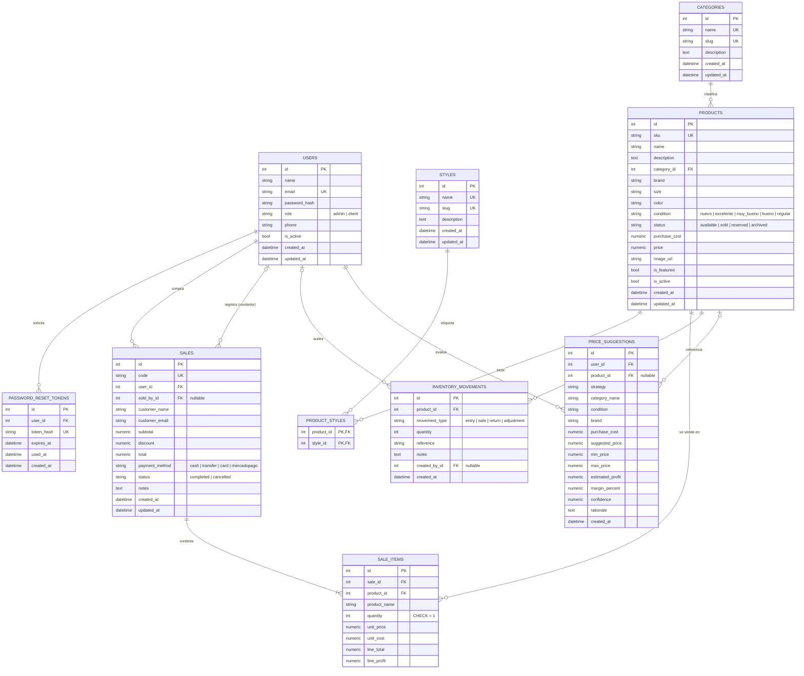

# Modelo de datos — DER y normalización

Base de datos: **SQLite 3** · 10 tablas · Tercera Forma Normal (3FN) · claves foráneas activas (`PRAGMA foreign_keys=ON`) · modo WAL.

El DDL completo y reproducible está en [`database/schema.sql`](../database/schema.sql); los datos demo en [`database/seed_demo.sql`](../database/seed_demo.sql).

---

## Diagrama entidad-relación



### Cardinalidades

| Relación | Cardinalidad | Regla de borrado |
| --- | --- | --- |
| `users` → `password_reset_tokens` | 1 : N | `CASCADE` |
| `users` → `sales` (`user_id`) | 1 : N | `RESTRICT` (no se borra un comprador con ventas) |
| `users` → `sales` (`sold_by_id`) | 0..1 : N | `SET NULL` |
| `categories` → `products` | 1 : N | `RESTRICT` (no se borra una categoría con prendas) |
| `products` ↔ `styles` | N : M | `CASCADE` en la tabla puente |
| `sales` → `sale_items` | 1 : N | `CASCADE` |
| `products` → `sale_items` | 1 : N | `RESTRICT` (se preserva el historial) |
| `products` → `inventory_movements` | 1 : N | `RESTRICT` |
| `products` → `price_suggestions` | 0..1 : N | `SET NULL` |

---

## Diccionario de datos

### `users`

| Columna | Tipo | Restricciones | Descripción |
| --- | --- | --- | --- |
| `id` | INTEGER | PK | Identificador subrogado. |
| `name` | VARCHAR(120) | NOT NULL | Nombre visible. |
| `email` | VARCHAR(255) | NOT NULL, UNIQUE | Login y contacto. |
| `password_hash` | VARCHAR(255) | NOT NULL | PBKDF2-SHA256 con sal. |
| `role` | VARCHAR(20) | NOT NULL, CHECK `admin/client` | Rol de autorización. |
| `phone` | VARCHAR(40) | NULL | Teléfono opcional. |
| `is_active` | BOOLEAN | NOT NULL | Baja lógica. |
| `created_at` / `updated_at` | DATETIME | NOT NULL | Auditoría. |

### `password_reset_tokens`

| Columna | Tipo | Restricciones | Descripción |
| --- | --- | --- | --- |
| `id` | INTEGER | PK | Identificador. |
| `user_id` | INTEGER | FK → `users.id`, CASCADE | Titular. |
| `token_hash` | VARCHAR(128) | NOT NULL, UNIQUE | SHA-256 del token (nunca se guarda el token plano). |
| `expires_at` | DATETIME | NOT NULL | Vencimiento. |
| `used_at` | DATETIME | NULL | Marca de un solo uso. |
| `created_at` | DATETIME | NOT NULL | Emisión. |

### `categories` y `styles`

| Columna | Tipo | Restricciones | Descripción |
| --- | --- | --- | --- |
| `id` | INTEGER | PK | Identificador. |
| `name` | VARCHAR | NOT NULL, UNIQUE | Nombre visible. |
| `slug` | VARCHAR | NOT NULL, UNIQUE | Identificador legible para URLs. |
| `description` | TEXT | NULL | Descripción editorial. |
| `created_at` / `updated_at` | DATETIME | NOT NULL | Auditoría. |

### `products`

| Columna | Tipo | Restricciones | Descripción |
| --- | --- | --- | --- |
| `id` | INTEGER | PK | Identificador. |
| `sku` | VARCHAR(40) | NOT NULL, UNIQUE | Código generado por categoría + aleatorio. |
| `name` | VARCHAR(160) | NOT NULL | Nombre de la prenda. |
| `description` | TEXT | NOT NULL | Descripción. |
| `category_id` | INTEGER | FK → `categories.id`, RESTRICT | Categoría. |
| `brand` | VARCHAR(80) | NULL | Marca. |
| `size` | VARCHAR(20) | NULL | Talle. |
| `color` | VARCHAR(50) | NULL | Color. |
| `condition` | VARCHAR(20) | NOT NULL, CHECK | Estado de conservación. |
| `status` | VARCHAR(20) | NOT NULL, CHECK | Disponibilidad. |
| `purchase_cost` | NUMERIC(12,2) | NOT NULL, CHECK ≥ 0 | Costo de compra (dato sensible). |
| `price` | NUMERIC(12,2) | NOT NULL, CHECK > 0 | Precio de venta. |
| `image_url` | VARCHAR(500) | NULL | Imagen. |
| `is_featured` | BOOLEAN | NOT NULL | Destacada en home. |
| `is_active` | BOOLEAN | NOT NULL | Baja lógica. |
| `created_at` / `updated_at` | DATETIME | NOT NULL | Auditoría. |

Índices: `status + is_active`, `category_id`, `name`.

### `product_styles`

| Columna | Tipo | Restricciones |
| --- | --- | --- |
| `product_id` | INTEGER | PK compuesta, FK → `products.id`, CASCADE |
| `style_id` | INTEGER | PK compuesta, FK → `styles.id`, CASCADE |

Resuelve la relación N:M sin grupos repetidos.

### `sales`

| Columna | Tipo | Restricciones | Descripción |
| --- | --- | --- | --- |
| `id` | INTEGER | PK | Identificador. |
| `code` | VARCHAR(30) | NOT NULL, UNIQUE | Código legible (`CV-...`). |
| `user_id` | INTEGER | FK → `users.id`, RESTRICT | Comprador. |
| `sold_by_id` | INTEGER | FK → `users.id`, SET NULL | Vendedor/operador. |
| `customer_name` / `customer_email` | VARCHAR | NULL | Snapshot de contacto. |
| `subtotal` | NUMERIC(12,2) | NOT NULL, CHECK ≥ 0 | Suma de líneas. |
| `discount` | NUMERIC(12,2) | NOT NULL, CHECK ≥ 0 | Descuento aplicado. |
| `total` | NUMERIC(12,2) | NOT NULL, CHECK ≥ 0 | Total cobrado. |
| `payment_method` | VARCHAR(20) | NOT NULL, CHECK | Medio de pago. |
| `status` | VARCHAR(20) | NOT NULL, CHECK | `completed` o `cancelled`. |
| `notes` | TEXT | NULL | Observaciones. |
| `created_at` / `updated_at` | DATETIME | NOT NULL | Fecha de venta. |

### `sale_items`

| Columna | Tipo | Restricciones | Descripción |
| --- | --- | --- | --- |
| `id` | INTEGER | PK | Identificador. |
| `sale_id` | INTEGER | FK → `sales.id`, CASCADE | Venta. |
| `product_id` | INTEGER | FK → `products.id`, RESTRICT | Prenda. |
| `product_name` | VARCHAR(160) | NOT NULL | Snapshot del nombre. |
| `quantity` | INTEGER | NOT NULL, CHECK = 1 | Stock unitario. |
| `unit_price` | NUMERIC(12,2) | NOT NULL, CHECK ≥ 0 | Precio al momento de la venta. |
| `unit_cost` | NUMERIC(12,2) | NOT NULL, CHECK ≥ 0 | Costo al momento de la venta. |
| `line_total` | NUMERIC(12,2) | NOT NULL | `unit_price × quantity`. |
| `line_profit` | NUMERIC(12,2) | NOT NULL | `(unit_price − unit_cost) × quantity`. |

Restricción `UNIQUE(sale_id, product_id)`: una prenda no puede repetirse en la misma venta.

### `inventory_movements`

| Columna | Tipo | Restricciones | Descripción |
| --- | --- | --- | --- |
| `id` | INTEGER | PK | Identificador. |
| `product_id` | INTEGER | FK → `products.id`, RESTRICT | Prenda. |
| `movement_type` | VARCHAR(20) | NOT NULL, CHECK | Ingreso, venta, devolución, ajuste. |
| `quantity` | INTEGER | NOT NULL, CHECK > 0 | Unidades. |
| `reference` | VARCHAR(60) | NULL | Código o motivo. |
| `notes` | TEXT | NULL | Detalle. |
| `created_by_id` | INTEGER | FK → `users.id`, SET NULL | Responsable. |
| `created_at` | DATETIME | NOT NULL | Fecha. |

### `price_suggestions`

| Columna | Tipo | Restricciones | Descripción |
| --- | --- | --- | --- |
| `id` | INTEGER | PK | Identificador. |
| `user_id` | INTEGER | FK → `users.id`, CASCADE | Administrador que evaluó. |
| `product_id` | INTEGER | FK → `products.id`, SET NULL | Prenda referenciada (opcional). |
| `strategy` | VARCHAR(30) | NOT NULL | `conservador`, `balanceado`, `agresivo`. |
| `category_name` | VARCHAR(80) | NOT NULL | Snapshot de categoría. |
| `condition` | VARCHAR(20) | NOT NULL, CHECK | Condición evaluada. |
| `brand` | VARCHAR(80) | NULL | Marca. |
| `purchase_cost` | NUMERIC(12,2) | NOT NULL | Costo de entrada. |
| `suggested_price` | NUMERIC(12,2) | NOT NULL | Precio recomendado. |
| `min_price` / `max_price` | NUMERIC(12,2) | NOT NULL | Rango sugerido. |
| `estimated_profit` | NUMERIC(12,2) | NOT NULL | Ganancia estimada. |
| `margin_percent` | NUMERIC(5,2) | NOT NULL | Margen sobre precio. |
| `confidence` | NUMERIC(5,2) | NOT NULL | Confianza del modelo. |
| `rationale` | TEXT | NULL | Justificación en texto. |
| `created_at` | DATETIME | NOT NULL | Fecha de evaluación. |

---

## Justificación de la Tercera Forma Normal

### Primera Forma Normal (1FN)

- Todas las columnas son atómicas: no hay listas, teléfonos múltiples ni pares clave-valor embebidos.
- La relación N:M entre prendas y estilos se resolvió con `product_styles`, no con una columna `styles` con valores separados por comas.
- Cada tabla tiene una clave primaria que identifica sus filas.

### Segunda Forma Normal (2FN)

- Todas las tablas usan una clave primaria simple (`id`), salvo `product_styles`, cuya clave es compuesta `(product_id, style_id)`.
- En `product_styles` no existe ningún atributo que dependa sólo de una parte de la clave: la tabla sólo representa la asociación.
- En `sale_items`, `unit_price`, `unit_cost`, `line_total` y `line_profit` dependen de la línea completa (venta + prenda), no de una parte.

### Tercera Forma Normal (3FN)

- `products` no repite el nombre de la categoría: almacena `category_id`, por lo que no hay dependencia transitiva `producto → categoría → nombre_categoría`.
- `sales` no repite el email ni el nombre del comprador como dependencia del usuario: guarda `user_id`; los campos `customer_name` y `customer_email` son *snapshots* deliberados del contacto al momento de la compra, no atributos derivados.
- `sale_items` guarda `product_name`, `unit_price` y `unit_cost` como *snapshots históricos*, no como copias dependientes del estado actual de `products`. Su valor debe permanecer inmutable aunque la prenda cambie de precio, nombre o sea dada de baja.
- Los reportes calculan agregados por consulta; no se almacenan contadores denormalizados que puedan quedar inconsistentes.
- `price_suggestions` guarda `category_name` como snapshot de la evaluación, porque la categoría puede renombrarse o eliminarse y el historial debe seguir siendo legible.

### Integridad

- **Entidad**: PK no nula y única en cada tabla.
- **Referencial**: FK con `RESTRICT`, `CASCADE` o `SET NULL` según la semántica del negocio.
- **Dominio**: `CHECK` para enums, precios, cantidades y totales; `UNIQUE` para emails, slugs, SKU, códigos de venta y pares venta-producto.
- **De negocio**: validadas en la capa de servicios (por ejemplo, precio > costo, no auto-desactivarse, no eliminar la última administradora).

---

## Operaciones y consistencia

| Operación | Tablas afectadas | Garantía |
| --- | --- | --- |
| Alta de prenda | `products`, `inventory_movements` | Transacción atómica; movimiento `entry`. |
| Checkout | `sales`, `sale_items`, `products`, `inventory_movements` | Actualización condicional de stock (`status='available'`) dentro de una transacción; si falla, rollback. |
| Cancelación | `sales`, `products`, `inventory_movements` | Estado `cancelled`, prenda vuelve a `available`, movimiento `return`. |
| Baja de prenda | `products`, `inventory_movements` | Baja lógica (`is_active=false`, `status=archived`); historial intacto. |
| Evaluación IA | `price_suggestions` | Registro inmutable de la sugerencia. |

---

## Cómo regenerar el esquema

```powershell
.\.venv\Scripts\python.exe scripts\export_schema.py
```

El script crea una base temporal desde los modelos SQLAlchemy, ejecuta el seed y exporta:

- `database/schema.sql`: DDL, constraints e índices.
- `database/seed_demo.sql`: 166 `INSERT` con los datos demo.
