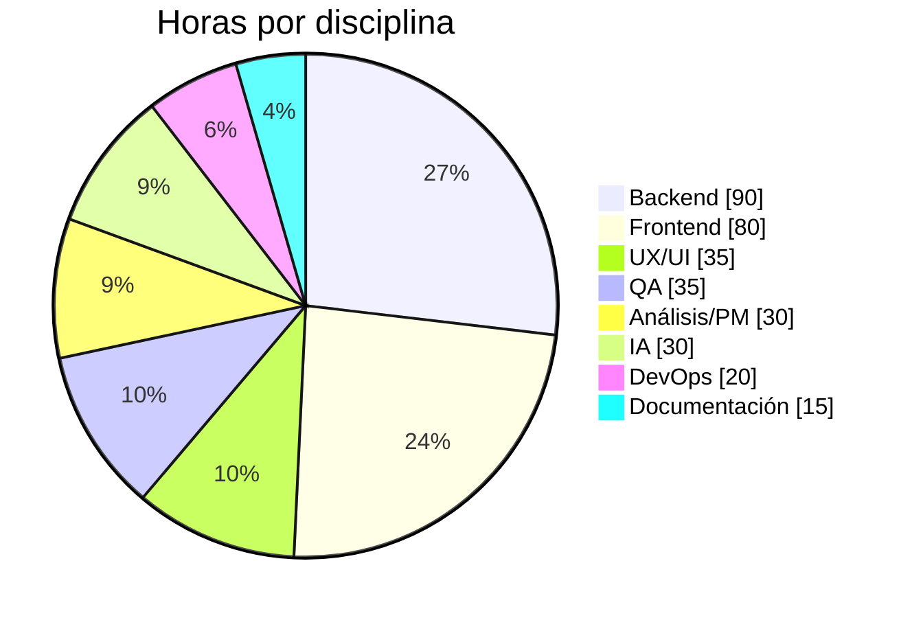

# Presupuesto y escalabilidad — CAOS Vintage

Estimación de implementación, operación y evolución técnica del sistema. Los valores están expresados en **USD** como unidad de referencia (proyecto académico, Argentina, 2026) y deben recalcularse según el tipo de cambio y el proveedor elegido.

---

## 1. Alcance valorizado

El presupuesto cubre el sistema entregado en este repositorio:

- Tienda pública responsive (home, catálogo con filtros, detalle, carrito, checkout, cuenta).
- Autenticación con JWT, roles, recuperación y cambio de contraseña.
- Backoffice completo: dashboard, ABM de prendas/categorías/estilos/usuarios, ventas y cancelaciones.
- Reportes de ventas, rentabilidad y stock con exportación CSV/XLSX/PDF.
- Dos módulos de IA: Personal Shopper y Evaluador de Precios con historial.
- Base SQLite en 3FN, seed demo, esquema SQL reproducible.
- Pruebas automatizadas, documentación, Docker y scripts de operación.

**No incluido**: pasarela de pagos real, envío de emails transaccionales, carga de imágenes a object storage, app móvil nativa, facturación electrónica ni integración con ERP.

---

## 2. Estimación por rol

| Rol | Horas | Tarifa ref. (USD/h) | Subtotal (USD) |
| --- | ---: | ---: | ---: |
| Análisis funcional / PM | 30 | 25 | 750 |
| UX/UI y diseño responsive | 35 | 22 | 770 |
| Desarrollo frontend (React/TS) | 80 | 24 | 1.920 |
| Desarrollo backend (FastAPI/SQL) | 90 | 26 | 2.340 |
| Módulos de IA y lógica de precios | 30 | 30 | 900 |
| QA, pruebas de integración y correcciones | 35 | 20 | 700 |
| DevOps, Docker y despliegue | 20 | 25 | 500 |
| Documentación y capacitación | 15 | 20 | 300 |
| **Subtotal** | **335** | — | **8.180** |
| Contingencia (15 %) | — | — | 1.227 |
| **Total estimado** | — | — | **≈ 9.400** |

**Rango razonable de mercado: USD 7.500 – 11.500**, según seniority, alcance de diseño y cantidad de rondas de revisión.

### Distribución del esfuerzo

### Forma de pago sugerida

| Hito | Porcentaje | Entregable |
| --- | ---: | --- |
| Inicio | 30 % | Relevamiento, arquitectura y DER aprobados. |
| MVP funcional | 40 % | Catálogo, auth, checkout y backoffice operativos. |
| Cierre | 30 % | Reportes, IA, pruebas, despliegue y documentación. |

---

## 3. Costos de operación (MVP)

| Concepto | Mensual (USD) | Notas |
| --- | ---: | --- |
| VPS 2 vCPU / 4 GB / 40 GB SSD | 12 – 30 | Hetzner, DigitalOcean, Fly.io o similar. |
| Dominio | 1 – 2 | Próximo a USD 12–25/año. |
| Backups + object storage | 3 – 8 | Snapshot diario de SQLite + imágenes. |
| Email transaccional | 0 – 15 | Plan gratuito hasta cierto volumen (Resend, Brevo). |
| Monitoreo / uptime | 0 – 20 | UptimeRobot gratuito o Sentry básico. |
| TLS | 0 | Let's Encrypt / Caddy. |
| **Total** | **25 – 90** | Sin incluir pasarela de pagos. |

### Costos variables

- **Pasarela de pagos** (Mercado Pago / Stripe): comisión por transacción, típicamente 3–6 %.
- **Mantenimiento evolutivo**: 8–12 h/mes (USD 200–350) para actualizaciones, backups verificados y mejoras menores.
- **Soporte**: hora adicional según tarifa del proveedor.

---

## 4. Escalabilidad técnica

### Etapa 0 — MVP / demo (estado actual)

- Un solo proceso FastAPI + SQLite en modo WAL.
- Hasta ~1.000 usuarios registrados y decenas de compras diarias.
- Ideal para validar el negocio con costo mínimo.
- **Límite**: escrituras concurrentes y tamaño de la base.

### Etapa 1 — Crecimiento inicial (1.000–10.000 usuarios)

| Cambio | Motivo | Costo aprox. |
| --- | --- | --- |
| SQLite → **PostgreSQL** | Concurrencia, integridad y backups online. | USD 15–50/mes |
| **Alembic** para migraciones | Versionado del esquema sin recrear tablas. | 8–12 h |
| Imágenes en **S3/R2** | No inflar la base ni el disco del VPS. | USD 5–20/mes |
| Emails transaccionales | Recuperación de contraseña real. | USD 0–15/mes |
| Backups automáticos + prueba de restore | Continuidad del negocio. | USD 3–10/mes |

### Etapa 2 — Escala media (10.000–100.000 usuarios)

| Cambio | Motivo |
| --- | --- |
| Réplicas del backend + reverse proxy (Caddy/Nginx) | Alta disponibilidad y despliegues sin downtime. |
| **Redis** para caché de catálogo y rate limiting | Menos carga a la base y protección ante abuso. |
| Cola de tareas (Celery/RQ) para exports y emails | Respuestas rápidas y trabajos pesados asíncronos. |
| CDN para la SPA y las imágenes | Latencia global y menor ancho de banda del servidor. |
| Observabilidad (Sentry, Prometheus/Grafana, logs centralizados) | Detección temprana de incidentes. |
| Búsqueda full-text (PostgreSQL `tsvector` o Meilisearch) | Búsqueda rápida y relevante. |

### Etapa 3 — Escala alta (>100.000 usuarios)

- Backend sin estado con autoescalado horizontal.
- PostgreSQL gestionado con réplicas de lectura y connection pooling (PgBouncer).
- Separación de la IA en un servicio propio si se migra a un LLM.
- Feature flags, CI/CD con ambientes de staging y pruebas E2E.
- Particionado o archivado de ventas históricas.
- SLOs, alertas y plan de recuperación ante desastres (RTO/RPO definidos).

### Comparativa de costos de infraestructura por etapa

| Etapa | Infra mensual (USD) | Equipo técnico |
| --- | ---: | --- |
| 0 — MVP | 25 – 90 | 1 dev full-stack |
| 1 — Crecimiento | 60 – 150 | 1 dev + soporte parcial |
| 2 — Escala media | 150 – 400 | 2–3 personas |
| 3 — Escala alta | 500 – 1.500+ | Equipo DevOps + backend |

---

## 5. Deuda técnica priorizada

| Prioridad | Ítem | Impacto | Esfuerzo |
| --- | --- | --- | --- |
| Alta | Migrar a PostgreSQL + Alembic | Concurrencia y evolución segura del esquema. | 2–3 días |
| Alta | Email real para recuperación de contraseña | Seguridad y experiencia de usuario. | 1 día |
| Alta | Backups automáticos con restore probado | Continuidad del negocio. | 0,5 día |
| Media | Refresh tokens / revocación de sesión | Seguridad en producción. | 1–2 días |
| Media | Subida de imágenes a object storage | Escalabilidad y rendimiento. | 1–2 días |
| Media | Rate limiting y protección antiabuso | Robustez y costos. | 1 día |
| Media | CI/CD + tests E2E (Playwright) | Calidad en cada release. | 2–3 días |
| Baja | Pasarela de pagos real | Conversión y automatización. | 3–5 días |
| Baja | Analítica de producto y embudo | Decisiones basadas en datos. | 2 días |
| Baja | Accesibilidad WCAG AA completa | Inclusión y cumplimiento. | 2–3 días |

---

## 6. Riesgos y mitigaciones

| Riesgo | Probabilidad | Impacto | Mitigación |
| --- | --- | --- | --- |
| Crecimiento del catálogo y fotos | Media | Alto | Object storage + CDN + imágenes optimizadas. |
| Picos de tráfico (campañas) | Media | Alto | Caché, CDN y réplicas del backend. |
| Pérdida de datos | Baja | Crítico | Backups diarios, WAL, restore verificado. |
| Fuga de secretos | Baja | Crítico | Variables de entorno, rotación, `DEBUG=false`. |
| Stock vendido dos veces | Baja | Alto | Actualización condicional atómica + constraint único (ya implementado). |
| Dependencia de un único proveedor | Media | Medio | Docker + PostgreSQL estándar facilitan la portabilidad. |
| Costos de IA por token (si se migra a LLM) | Media | Medio | Cache de respuestas, límites por usuario y fallback al motor local. |

---

## 7. Retorno de la inversión (referencia)

Con un ticket promedio de **USD 30–60** y un margen bruto del **50–65 %** (típico en vintage), la inversión de USD 9.400 se recupera aproximadamente con:

- **300–500 ventas** si se destina el 100 % del margen, o
- **600–1.000 ventas** destinando la mitad del margen a operación y crecimiento.

A modo ilustrativo: 40 ventas mensuales × USD 40 × 55 % de margen ≈ **USD 880/mes** de contribución, lo que permitiría recuperar la inversión en **11–12 meses** sin considerar costos de adquisición de clientes.

> Los valores son orientativos y deben validarse con el plan comercial real, impuestos y comisiones de pago.

---

## 8. Recomendaciones finales

1. **Mantener SQLite en la demo** por su simplicidad, pero planificar PostgreSQL antes de abrir al público con pagos reales.
2. **Activar HTTPS y una `SECRET_KEY` robusta** desde el primer despliegue público.
3. **Implementar emails reales** para recuperación de contraseña y confirmación de compra.
4. **Automatizar backups** y probar la restauración al menos una vez por trimestre.
5. **Instrumentar métricas** (ventas, conversión, prendas más vistas) para decidir con datos.
6. **Mantener la IA local** mientras el volumen sea bajo: costo cero por consulta y privacidad; evaluar un LLM sólo si se necesita lenguaje más abierto.
7. **Agregar CI/CD** con lint, tests y build antes de cada despliegue.
