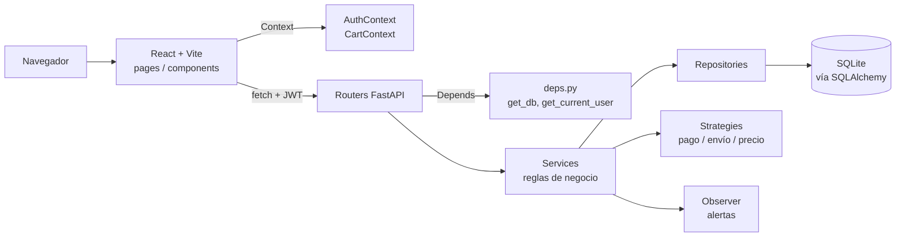

# Plan del parcial — CAOS Vintage

Etapa 0: diagnóstico del repo, estructura, DER, endpoints y reparto de tareas.
**Nada de esto se programa hasta que las dos den el OK.**

Integrantes:

| | Nombre | GitHub | Email de Git |
|---|---|---|---|
| Persona A | Lourdes Amado | `luluamadosm` | `lourdesamado233@gmail.com` |
| Persona B | Guadalupe Arroyo | `guadarroyofl` | `guadalupearroyo2005@gmail.com` |

---

## 1. Qué hay hoy en el repo

Revisé la rama `main` (es la única que existe). Esto es lo que encontré, de lo más urgente a lo menos urgente.

**a) Cuatro commits de Guada tienen el email mal escrito.** Los commits del 10, 11 y 19 de septiembre (el inicial, los dos del README y el del patrón Strategy) dicen `guadalupearroyo2005@fmail.com`, con **f** en vez de **g**. GitHub asigna cada commit a una cuenta buscando el email, así que esos cuatro commits **no le cuentan a la cuenta `guadarroyofl`**: en GitHub aparecen sin su foto y no suman en el gráfico de contribuciones. Los otros tres (los de la bitácora) sí tienen el email correcto, porque se hicieron desde la web de GitHub.

Hoy `git shortlog -sne` muestra esto:

```
4  Guadalupe Arroyo <guadalupearroyo2005@fmail.com>
3  guadarroyofl <guadalupearroyo2005@gmail.com>
```

Git ve dos personas distintas aunque las dos sean Guada. Hay que hacer dos cosas:

1. Que Guada corrija su configuración **antes** de hacer cualquier commit nuevo (comandos en la sección 2).
2. Agregar un archivo `.mailmap` en la raíz del repo. Es un archivo estándar de Git que le dice "estas dos identidades son la misma persona". Con él, `git shortlog` las suma: 7 commits de Guada. No reescribe la historia ni cambia lo que muestra GitHub, solo unifica el conteo local, que es el que vamos a usar para controlar el balance.

**b) Lourdes tiene 0 commits.** El balance arranca 7 a 0. Por eso, en la etapa 1 casi todas las tareas con commits son de Lourdes (sección 6).

**c) Se subió `__pycache__/`.** Son archivos `.pyc` que Python genera solo al ejecutar el código. No son código fuente, cambian en cada compu y ensucian el repo. El `.gitignore` actual cubre Node y editores, pero no Python. Hay que agregar `__pycache__/`, `*.pyc`, `*.db` (la base SQLite), `uploads/` (las fotos que se suben en desarrollo) y `dist/` (el build del front), y sacar del repo los `.pyc` que ya están.

**d) Hay commits duplicados.** "actualizar README…" aparece dos veces y "agrega entrada de bitácora" también. No hay que borrarlos (reescribir historia ya publicada trae más problemas que soluciones), pero desde ahora rige "un cambio lógico por commit".

**e) El README describe otro proyecto.** Habla de MVC, de scripts SQL a mano en `/database` y de tres módulos innovadores (chatbot de estilo con IA, evaluador de precios con IA y visor 3D) que no coinciden con lo que pide el parcial. Se reescribe en la etapa 8, pero **antes necesitamos que decidan qué pasa con esos módulos** (sección 7).

**f) Lo que sí sirve tal cual: `src/backend/pricing/`.** Es el evaluador de precios con patrón Strategy del TP2 (`MargenFijo`, `CategoriaYMarca`, `EvaluadorIA` con cliente simulado). Propongo moverlo al back nuevo e integrarlo al panel admin como "precio sugerido" al cargar una prenda. Así el trabajo del TP2 queda dentro del parcial y en la defensa tienen un tercer ejemplo de Strategy, además de los de pago y envío.

**g) No hay rama `develop`, ni protección de `main`, ni tablero, ni issues.** Todo eso se arma en la etapa 1.

---

## 2. Verificación de identidad (cada una, antes de empezar)

Cada una corre esto en su compu y nos pega el resultado:

```bash
git config --global user.name
git config --global user.email
```

Tiene que dar exactamente:

- Lourdes → `Lourdes Amado` / `lourdesamado233@gmail.com`
- Guada → `Guadalupe Arroyo` / `guadalupearroyo2005@gmail.com`

Si no coincide, se corrige así (ejemplo de Guada):

```bash
git config --global user.name "Guadalupe Arroyo"
git config --global user.email "guadalupearroyo2005@gmail.com"
```

**Si trabajan en una sola compu.** El autor de cada commit tiene que ser quien hizo esa tarea. La forma más segura es configurar la identidad **solo para este repo** (sin `--global`) cada vez que se sienta la otra:

```bash
# se sienta Guada
git config user.name "Guadalupe Arroyo"
git config user.email "guadalupearroyo2005@gmail.com"

# antes de commitear, siempre verificar quién está "logueada" en Git:
git config user.email
```

Otra opción es dejar la configuración de Lourdes y que Guada agregue `--author` en cada commit suyo:

```bash
git commit -m "feat(auth): agrega login" --author="Guadalupe Arroyo <guadalupearroyo2005@gmail.com>"
```

El `push` se hace con la cuenta de GitHub que esté logueada en esa compu. No pasa nada: GitHub asigna el commit por el **email del autor**, no por quién lo subió. Los Pull Requests sí se abren y se aprueban desde la cuenta de cada una en la web. Una persona no puede aprobar su propio PR, así que Guada tiene que entrar con su cuenta (por ejemplo, en otro perfil del navegador) para aprobar los de Lourdes y abrir los suyos.

---

## 3. Estructura de carpetas propuesta

Propongo dos carpetas en la raíz, `backend/` y `frontend/`, en lugar de `src/backend` y `src/frontend`. Así cada parte tiene sus dependencias (`requirements.txt` y `package.json`) y se corre por separado, que es lo habitual en proyectos con front y back en un mismo repo (lo que se llama monorepo). El módulo de pricing se mueve con `git mv`, que conserva su historial.

```
metodologia_sistemas/
├── backend/
│   ├── app/
│   │   ├── main.py                 # crea la app FastAPI y registra los routers
│   │   ├── core/
│   │   │   ├── config.py           # lee variables de entorno (.env)
│   │   │   ├── database.py         # motor SQLite + sesión de SQLAlchemy
│   │   │   ├── security.py         # bcrypt y JWT
│   │   │   └── deps.py             # dependencias inyectables: get_db, get_current_user, require_admin
│   │   ├── models/                 # tablas (SQLAlchemy): una clase por entidad del DER
│   │   ├── schemas/                # forma de los datos que entran y salen (Pydantic)
│   │   ├── repositories/           # acceso a datos: consultas a la base (patrón Repository)
│   │   ├── services/               # reglas de negocio (patrón Service Layer)
│   │   │   ├── pagos/              # Strategy: PagoSimulado, PagoMercadoPago
│   │   │   ├── envios/             # Strategy: RetiroEnFeria, EnvioCorreo, Moto
│   │   │   ├── pricing/            # Strategy del TP2 (movido desde src/backend/pricing)
│   │   │   └── alertas/            # Observer: avisa cuando entra una prenda que coincide
│   │   └── routers/                # endpoints HTTP: reciben, validan y delegan al service
│   ├── scripts/seed.py             # carga 20+ prendas de ejemplo
│   ├── tests/                      # pytest
│   ├── uploads/                    # fotos subidas en desarrollo (ignorada por Git)
│   ├── requirements.txt
│   └── .env.example                # variables necesarias, sin valores secretos
├── frontend/
│   ├── src/
│   │   ├── api/                    # funciones que llaman al back (fetch + token)
│   │   ├── context/                # AuthContext y CartContext (patrón Provider)
│   │   ├── hooks/                  # useCountdown, useAuth, useCart
│   │   ├── components/             # piezas reutilizables: PrendaCard, Filtros, Countdown…
│   │   ├── pages/                  # una por ruta: Catalogo, DetallePrenda, Carrito, Admin…
│   │   ├── types/                  # tipos TypeScript que espejan los schemas del back
│   │   ├── styles/                 # variables de color y tipografía y2k/punk
│   │   ├── App.tsx                 # rutas (React Router)
│   │   └── main.tsx
│   ├── index.html
│   ├── package.json
│   ├── tsconfig.json
│   └── vite.config.ts
├── docs/
│   ├── bitacora.md                 # ya existe; se sigue usando
│   ├── plan-parcial.md             # este documento
│   ├── der.md                      # DER en Mermaid
│   └── arquitectura.md
├── .github/
│   ├── pull_request_template.md
│   └── ISSUE_TEMPLATE/tarea.md
├── .gitignore
├── .mailmap
└── README.md
```

**Por qué el back está en capas.** Cada capa tiene un solo trabajo:

- El **router** solo habla HTTP: recibe el pedido, valida con Pydantic y devuelve la respuesta.
- El **service** decide las reglas. Por ejemplo: "no se puede reservar una prenda ya reservada" o "un pedido pagado no vuelve a pendiente".
- El **repository** solo sabe consultar la base.
- El **model** describe la tabla.

Si mañana cambiamos SQLite por PostgreSQL, se toca el repository y nada más. Si cambia una regla de negocio, se toca el service. Y cada pieza se puede testear por separado.



---

## 4. DER (modelo de datos)

```mermaid
erDiagram
    USUARIO ||--o{ RESERVA : hace
    USUARIO ||--o{ PEDIDO : realiza
    USUARIO ||--o{ LOOK : arma
    USUARIO ||--o{ ALERTA_BUSQUEDA : guarda
    USUARIO ||--o{ NOTIFICACION : recibe
    USUARIO ||--o{ AVISO_DROP : pide

    CATEGORIA ||--o{ PRENDA : clasifica
    FERIA ||--o{ PRENDA : origen
    DROP ||--o{ PRENDA : agrupa
    DROP ||--o{ AVISO_DROP : tiene

    PRENDA ||--o{ IMAGEN_PRENDA : tiene
    PRENDA ||--o{ MEDIDA_PRENDA : tiene
    PRENDA ||--o{ PRENDA_ESTILO : etiquetada
    ESTILO ||--o{ PRENDA_ESTILO : etiqueta
    PRENDA ||--o{ RESERVA : reservada_en
    PRENDA ||--o| PEDIDO_ITEM : vendida_en
    PEDIDO ||--|{ PEDIDO_ITEM : contiene
    LOOK ||--|{ LOOK_PRENDA : incluye
    PRENDA ||--o{ LOOK_PRENDA : aparece_en
    CATEGORIA ||--o{ ALERTA_BUSQUEDA : filtra
    PRENDA ||--o{ NOTIFICACION : menciona

    USUARIO {
        int id PK
        string nombre
        string email UK
        string password_hash
        string rol "cliente | admin"
        datetime creado_en
    }
    CATEGORIA {
        int id PK
        string nombre UK
        float agua_litros_estimada "para el contador de impacto"
        float co2_kg_estimado
    }
    FERIA {
        int id PK
        string nombre
        string ubicacion
    }
    ESTILO {
        int id PK
        string nombre UK "y2k, punk, denim, band tee..."
    }
    DROP {
        int id PK
        string nombre
        string descripcion
        datetime publica_en
    }
    PRENDA {
        int id PK
        string titulo
        string descripcion
        string marca
        string talle
        int decada "1970, 1980, 1990, 2000"
        int estado "1 a 5"
        string estado_detalle
        decimal precio
        decimal precio_compra "solo lo ve admin"
        string publicacion "borrador | publicada | vendida"
        int categoria_id FK
        int feria_id FK
        int drop_id FK "nullable"
        datetime creado_en
    }
    MEDIDA_PRENDA {
        int id PK
        int prenda_id FK
        string nombre "largo, axila a axila, cintura..."
        float valor_cm
    }
    IMAGEN_PRENDA {
        int id PK
        int prenda_id FK
        string url
        int orden
    }
    PRENDA_ESTILO {
        int prenda_id PK, FK
        int estilo_id PK, FK
    }
    RESERVA {
        int id PK
        int prenda_id FK
        int usuario_id FK
        datetime creada_en
        datetime expira_en "creada_en + 15 min"
        string estado "activa | confirmada | expirada | cancelada"
    }
    PEDIDO {
        int id PK
        int usuario_id FK
        string estado "pendiente | pagado | enviado | entregado | cancelado"
        string metodo_pago
        string metodo_envio
        decimal costo_envio
        decimal total
        string direccion_envio
        float agua_ahorrada_l
        float co2_ahorrado_kg
        datetime creado_en
    }
    PEDIDO_ITEM {
        int id PK
        int pedido_id FK
        int prenda_id FK, UK "una prenda se vende una sola vez"
        decimal precio_unitario "precio congelado al comprar"
    }
    LOOK {
        int id PK
        int usuario_id FK
        string nombre
        string slug UK "para el link compartible"
        datetime creado_en
    }
    LOOK_PRENDA {
        int look_id PK, FK
        int prenda_id PK, FK
        int posicion
    }
    ALERTA_BUSQUEDA {
        int id PK
        int usuario_id FK
        string texto "campera de jean"
        int categoria_id FK "nullable"
        string talle "nullable"
        int decada "nullable"
        decimal precio_max "nullable"
        bool activa
    }
    NOTIFICACION {
        int id PK
        int usuario_id FK
        string tipo "alerta | drop"
        string mensaje
        int prenda_id FK "nullable"
        bool leida
        datetime creada_en
    }
    AVISO_DROP {
        int usuario_id PK, FK
        int drop_id PK, FK
    }
```



**Decisiones del modelo que conviene saber explicar:**

- **No hay tabla "carrito".** El carrito de un usuario son sus reservas activas. Como cada prenda es única, agregarla al carrito y reservarla es lo mismo: si la guardáramos aparte, podrían quedar dos personas con la misma prenda en el carrito. El `CartContext` del front solo muestra lo que el back confirma.
- **"Reservada" no se guarda en la prenda.** Se calcula: una prenda está reservada si tiene una reserva `activa` cuyo `expira_en` todavía no pasó. Si lo guardáramos como estado de la prenda, alguien tendría que acordarse de volverlo atrás a los 15 minutos. Calculado, la reserva vence sola por definición. Además, una tarea periódica marca como `expirada` las reservas vencidas, para que la base quede prolija.
- **`pedido_item.prenda_id` es único.** Es la garantía, a nivel base de datos, de que una prenda no se puede vender dos veces aunque el código tenga un error.
- **`precio_unitario` se copia al pedido.** Si después la dueña cambia el precio de la prenda, el historial del cliente sigue mostrando lo que pagó.
- **Medidas en tabla aparte.** Una campera tiene "manga" y un jean tiene "tiro"; con columnas fijas habría muchas vacías. Es la misma lógica de normalización que ya documentaron (3FN).
- **Los valores de impacto están en `categoria`.** Una remera ahorra distinto que un jean. El valor por categoría se toma de una fuente citada, que se documenta en la etapa 7. El pedido guarda el total calculado en el momento de la compra.
- **`estilo` y `prenda_estilo`** ya estaban en el README original; se mantienen para las etiquetas y2k, punk, etc.

---

## 5. Endpoints de la API

Todos bajo el prefijo `/api`. La documentación interactiva queda en `/docs` (Swagger, generado solo por FastAPI).
Acceso: 🌐 público · 👤 usuario logueado · 🔑 solo admin.

### Auth y perfil
| Método | Ruta | Acceso | Qué hace |
|---|---|---|---|
| POST | `/auth/register` | 🌐 | Crea un usuario cliente (contraseña hasheada con bcrypt) |
| POST | `/auth/login` | 🌐 | Devuelve un JWT |
| GET | `/auth/me` | 👤 | Datos del usuario del token |
| PUT | `/usuarios/me` | 👤 | Edita nombre y contraseña |

### Catálogo
| Método | Ruta | Acceso | Qué hace |
|---|---|---|---|
| GET | `/prendas` | 🌐 | Lista con búsqueda y filtros: `q`, `categoria`, `decada`, `talle`, `estado_min`, `precio_min`, `precio_max`, `estilo`, `orden`, `pagina` |
| GET | `/prendas/{id}` | 🌐 | Detalle: fotos, medidas, estado, década, feria, si está reservada |
| GET | `/categorias` · `/estilos` · `/ferias` | 🌐 | Opciones para armar los filtros |

### Carrito y reservas
| Método | Ruta | Acceso | Qué hace |
|---|---|---|---|
| GET | `/carrito` | 👤 | Reservas activas con el tiempo restante de cada una |
| POST | `/carrito` | 👤 | Reserva una prenda por 15 minutos (`409` si ya está reservada o vendida) |
| DELETE | `/carrito/{reserva_id}` | 👤 | Libera la reserva |

### Checkout y pedidos
| Método | Ruta | Acceso | Qué hace |
|---|---|---|---|
| GET | `/checkout/opciones` | 👤 | Métodos de pago y envío disponibles, con su costo |
| POST | `/pedidos` | 👤 | Confirma la compra de las reservas activas (Strategy de pago y de envío) |
| GET | `/pedidos` | 👤 | Historial del usuario |
| GET | `/pedidos/{id}` | 👤 | Detalle, con el ahorro de agua y CO2 |

### Panel admin
| Método | Ruta | Acceso | Qué hace |
|---|---|---|---|
| POST | `/admin/prendas` | 🔑 | Alta de prenda |
| PUT | `/admin/prendas/{id}` | 🔑 | Modificación |
| DELETE | `/admin/prendas/{id}` | 🔑 | Baja (lógica si ya fue vendida, para no romper pedidos) |
| POST | `/admin/prendas/{id}/imagenes` | 🔑 | Sube fotos |
| DELETE | `/admin/imagenes/{id}` | 🔑 | Borra una foto |
| POST | `/admin/precio-sugerido` | 🔑 | Evaluador de precios del TP2 (Strategy) |
| GET | `/admin/pedidos` | 🔑 | Lista filtrable por estado |
| PATCH | `/admin/pedidos/{id}/estado` | 🔑 | Avanza el estado: pendiente → pagado → enviado → entregado |
| GET | `/admin/metricas` | 🔑 | Ventas del mes, ticket promedio, prendas por estado, categoría más vendida |
| POST · PUT · DELETE | `/admin/drops[/{id}]` | 🔑 | ABM de drops |

### Funcionalidades innovadoras
| Método | Ruta | Acceso | Qué hace |
|---|---|---|---|
| GET | `/drops` · `/drops/{id}` | 🌐 | Próximos drops con cuenta regresiva; las prendas se ven recién al publicarse |
| POST · DELETE | `/drops/{id}/avisame` | 👤 | Anotarse o borrarse del aviso |
| POST | `/looks` | 👤 | Guarda un outfit (lista de prendas) y genera un slug |
| GET | `/looks` | 👤 | Mis looks |
| GET | `/looks/compartido/{slug}` | 🌐 | Ver un look desde el link compartido |
| DELETE | `/looks/{id}` | 👤 | Borra un look |
| GET · POST | `/alertas` | 👤 | Mis alertas de búsqueda / crear una |
| DELETE | `/alertas/{id}` | 👤 | Borra una alerta |
| GET | `/notificaciones` | 👤 | Avisos de alertas y drops |
| PATCH | `/notificaciones/{id}/leida` | 👤 | Marca como leída |
| GET | `/impacto/metodologia` | 🌐 | Cómo se calcula el ahorro y de qué fuentes sale |

---

## 6. Reparto de tareas (issues)

Regla: cada tarea es un issue del tablero, se trabaja en su rama `feature/…` y entra a `develop` por un PR que aprueba la otra. Los commits estimados son orientativos; al cerrar cada etapa se cuenta con `git shortlog -sne` y se ajusta el reparto de la siguiente.

**Punto de partida: Guada 7, Lourdes 0.** Por eso la etapa 1 carga a Lourdes.

| # | Etapa | Tarea | Quién | Lado | Commits est. |
|---|---|---|---|---|---|
| T1 | 1 | Ampliar `.gitignore` y sacar `__pycache__` del repo | A | repo | 2 |
| T2 | 1 | `.mailmap` + plantillas de PR y de issue | A | repo | 3 |
| T3 | 1 | Reorganizar carpetas (`git mv` del pricing), agregar este plan y corregir rutas en la bitácora | A | repo | 3 |
| T4 | 1 | Corregir su identidad de Git, crear `develop`, proteger `main`, armar el tablero, las etiquetas y los issues | B | GitHub | 0 (configuración) |
| | | **Acumulado** | | | **A 8 · B 7** |
| T5 | 2 | Esqueleto del back: `requirements`, `config`, `database`, `main` con `/health`, `.env.example` | B | back | 4 |
| T6 | 2 | Modelos del catálogo: usuario, categoría, feria, estilo, prenda, medida, imagen | A | back | 4 |
| T7 | 2 | Modelos transaccionales: reserva, pedido, ítem, drop, look, alerta, notificación | B | back | 4 |
| T8 | 2 | Esqueleto del front: Vite + TS, router, layout, tema y2k, cliente de API | A | front | 4 |
| | | **Acumulado** | | | **A 16 · B 15** |
| T9 | 3 | Auth back: bcrypt, JWT, repo y service de usuarios, router, `require_admin` | B | back | 5 |
| T10 | 3 | Auth front: `AuthContext`, login, registro, rutas protegidas, perfil | A | front | 5 |
| | | **Acumulado** | | | **A 21 · B 20** |
| T11 | 4 | Catálogo back: repo con filtros y paginación, service, routers | A | back | 4 |
| T12 | 4 | Script semilla con 20+ prendas | B | back | 3 |
| T13 | 4 | Catálogo front: grilla, filtros, búsqueda, paginación | B | front | 4 |
| T14 | 4 | Detalle front: galería, medidas, estado 1–5 | A | front | 3 |
| | | **Acumulado** | | | **A 28 · B 27** |
| T15 | 5 | Reservas back: service de 15 min, expiración, router carrito | B | back | 4 |
| T16 | 5 | Carrito front: `CartContext`, `useCountdown`, página carrito | A | front | 4 |
| T17 | 5 | Checkout back: Strategy de pago y envío, pedidos, cálculo de impacto | A | back | 4 |
| T18 | 5 | Checkout front + historial de pedidos | B | front | 4 |
| | | **Acumulado** | | | **A 36 · B 35** |
| T19 | 6 | Admin back: ABM de prendas + subida de imágenes | B | back | 4 |
| T20 | 6 | Admin back: estados de pedido, métricas, precio sugerido | A | back | 4 |
| T21 | 6 | Admin front: ABM de prendas | A | front | 4 |
| T22 | 6 | Admin front: pedidos y métricas | B | front | 4 |
| | | **Acumulado** | | | **A 44 · B 43** |
| T23 | 7 | Drops (back + front) | B | full | 5 |
| T24 | 7 | Armá tu look (back + front) | A | full | 5 |
| T25 | 7 | Alertas de búsqueda con Observer (back + front) | B | full | 5 |
| T26 | 7 | Contador de impacto (back + front + metodología con fuentes) | A | full | 4 |
| | | **Acumulado** | | | **A 53 · B 53** |
| T27 | 8 | Tests: auth y pedidos | A | back | 3 |
| T28 | 8 | Tests: reservas y alertas | B | back | 3 |
| T29 | 8 | README final con DER y diagrama de arquitectura | A | docs | 2 |
| T30 | 8 | Ajustes responsive y Swagger documentado (tags, descripciones) | B | full | 3 |
| | | **Total estimado** | | | **A 58 · B 59** |

Diferencia final estimada: 1 commit (menos del 2 %, muy por debajo del 10 % permitido).

---

## 7. Decisiones tomadas (2/11/2026)

1. **Módulos innovadores:** quedan los cinco del parcial (reserva temporal, drops, armá tu look, alertas de búsqueda, contador de impacto). El evaluador de precios del TP2 se conserva como "precio sugerido" en el panel admin. El chatbot con IA y el visor 3D pasan a "trabajo futuro" en el README.
2. **Carpetas:** `src/backend/pricing` se mueve a `backend/app/services/pricing` con `git mv`, para conservar su historial.
3. **Pago:** simulado al principio. Mercado Pago sandbox se suma al final como otra estrategia, si hay tiempo.
4. **Envíos:** retiro en feria (gratis), moto en Concepción (costo fijo) y correo (costo por zona).
5. **Merge de los PR:** solo "Rebase and merge". Así no se generan commits de merge a nombre de quien aprieta el botón, y el conteo de commits refleja solo el trabajo de cada una.

---

## 8. Posibles preguntas de la profe (etapa 0)

**¿Por qué el carrito no es una tabla?**
Porque cada prenda es única. Si el carrito fuera solo una lista en el navegador o una tabla aparte, dos personas podrían tener la misma prenda y una de las dos se enteraría recién al pagar. Al hacer que "agregar al carrito" sea crear una reserva en el back, el sistema garantiza que en cada momento hay como máximo una persona con esa prenda. La reserva vence a los 15 minutos para que nadie bloquee prendas indefinidamente.

**¿Para qué separar routers, services y repositories si con un solo archivo funciona?**
Porque cada capa cambia por motivos distintos. El router cambia si cambia la API. El service, si cambia una regla del negocio. El repository, si cambia la base de datos. Separarlas permite testear las reglas sin levantar un servidor y cambiar una parte sin romper las otras. FastAPI ayuda con la inyección de dependencias (`Depends`): el router pide "una sesión de base" o "el usuario actual" y FastAPI se lo entrega, en lugar de que cada endpoint lo cree a mano. Eso también permite reemplazarlos por versiones de prueba en los tests.

**¿Para qué sirve la rama `develop` si ya tienen `main`?**
`main` representa lo que se puede mostrar o entregar en cualquier momento, siempre estable. `develop` es donde se integra el trabajo de las dos y se prueba que todo funcione junto. Cada funcionalidad nace en su propia rama `feature/…`, entra a `develop` por un Pull Request revisado por la otra persona, y solo cuando `develop` está estable se pasa a `main`. Así un error a medio terminar nunca llega a la versión entregable, y cada cambio tiene un registro de quién lo hizo y quién lo revisó.
